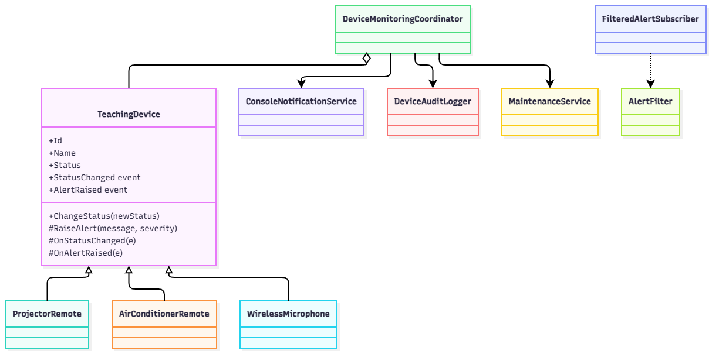

# Lab W08 – Delegate & Event

**Sinh viên:** Nguyễn Phúc Trường An – 202419022

Hệ thống giám sát thiết bị phòng học (remote máy chiếu, remote điều hòa, micro không dây) dùng **delegate & event** trong C# (.NET 8).
Thiết bị chỉ phát hiện và công bố sự kiện, không cần biết ai xử lý.

## Chạy chương trình

```bash
dotnet run
```

## Cấu trúc

```
src/
├─ enums/         DeviceStatus, AlertSeverity
├─ events/        DeviceStatusChangedEventArgs, DeviceAlertEventArgs
├─ exceptions/    InvalidDeviceReadingException
├─ devices/       TeachingDevice (abstract), ProjectorRemote, AirConditionerRemote, WirelessMicrophone
├─ subscribers/   ConsoleNotificationService, DeviceAuditLogger, MaintenanceService, FilteredAlertSubscriber
├─ AlertFilter.cs                  delegate lọc cảnh báo
├─ DeviceMonitoringCoordinator.cs  gom toàn bộ += / -=
└─ main.cs                         demo
```

## Sơ đồ lớp



## Event

| Event | Publisher | Subscriber |
|---|---|---|
| `StatusChanged` | `TeachingDevice.ChangeStatus` | `DeviceAuditLogger` |
| `AlertRaised` | `RaiseAlert` (lớp con) | `ConsoleNotificationService`, `MaintenanceService`, `FilteredAlertSubscriber` |

## Quyết định thiết kế

- **Chỉ cảnh báo khi đổi vùng** (`Normal → Low → Empty`) để tránh spam. Pin hồi phục thì không cảnh báo.
  - Máy chiếu: pin `< 20%` → Warning, `0%` → Critical.
  - Micro: pin `< 30%`, tín hiệu `< 40%` → Warning, `0%` → Critical. Hai chỉ số xét độc lập.
- **Điều hòa:** chỉ cảnh báo Critical khi chuyển từ phản hồi sang không phản hồi.
- Giá trị ngoài `0–100` → ném `InvalidDeviceReadingException`, **không thay đổi state**.
- `ChangeStatus` gán trạng thái mới **trước** rồi mới raise event. Không raise nếu trạng thái không đổi.
- `DeviceMonitoringCoordinator` không đăng ký trùng. `Dispose()` gọi `Unsubscribe()`, sau đó `Subscribe()` ném `ObjectDisposedException`.

